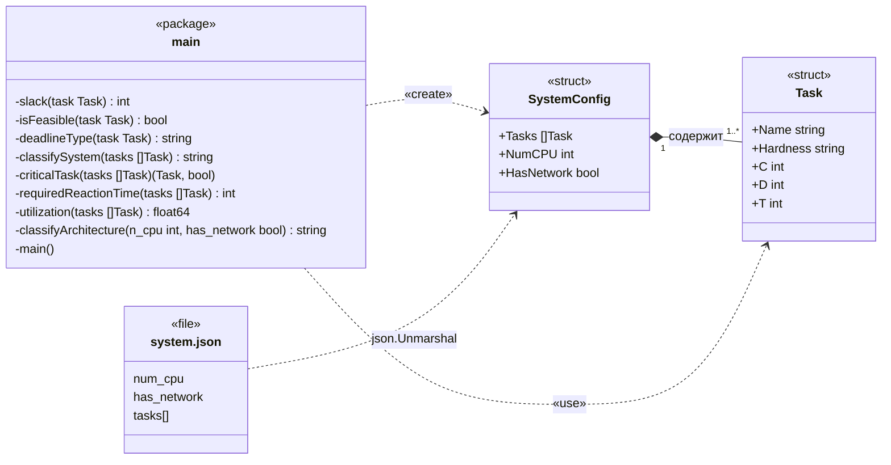

# RealTimeSystemAnalyzer

Консольное приложение на Go для классификации системы реального времени и расчёта её временных характеристик.

Практическая работа №1 по дисциплине «Вычислительные системы реального времени»: «Классификация систем реального времени и расчёт требуемого времени реакции». Вариант: узел АСУ ТП (приём телеметрии, регулирование, обмен по промышленной сети, диагностика).

## Возможности

Программа читает набор периодических задач и параметры системы из файла `system.json` и:

- классифицирует каждую задачу по жёсткости и определяет класс системы: жёсткого реального времени, если есть хотя бы одна жёсткая задача, иначе мягкого;
- определяет тип дедлайна каждой задачи: неявный (`D = T`), ограниченный (`D < T`) или произвольный (`D > T`);
- вычисляет запас `L = D − C` и признак выполнимости дедлайна (`L ≥ 0`, `C ≥ 0`);
- находит критическую задачу — жёсткую задачу с наименьшим запасом;
- рассчитывает требуемое время реакции `R_треб = min(D)` по жёстким задачам (при их отсутствии — по всем);
- вычисляет коэффициент загрузки `U = Σ(Cᵢ / Tᵢ)` и проверяет необходимое условие `U ≤ 1`;
- определяет архитектурный класс системы: однопроцессорная, многопроцессорная или распределённая;
- выводит выровненную таблицу по задачам и текстовое заключение.

## Требования

- Go 1.27 (версия указана в `go.mod`);
- только стандартная библиотека: `encoding/json`, `fmt`, `math`, `os`, `text/tabwriter`.

## Запуск

Файл `system.json` читается из текущего каталога, поэтому программу нужно запускать из корня репозитория:

```bash
go run .
```

Сборка исполняемого файла:

```bash
go build -o RealTimeSystemAnalyzer.exe .
./RealTimeSystemAnalyzer.exe
```

## Входные данные

Время задаётся в миллисекундах. Класс жёсткости: `жёсткое`, `твёрдое` или `мягкое`.

```json
{
  "num_cpu": 1,
  "has_network": false,
  "tasks": [
    { "name": "приём телеметрии", "hardness": "жёсткое", "c": 1, "d": 5, "t": 5 },
    { "name": "регулирование",    "hardness": "жёсткое", "c": 2, "d": 10, "t": 10 }
  ]
}
```

| Поле          | Тип     | Описание                                  |
|---------------|---------|-------------------------------------------|
| `num_cpu`     | int     | число процессоров                         |
| `has_network` | bool    | наличие сети (распределённая система)     |
| `tasks[].name`     | string | имя задачи                           |
| `tasks[].hardness` | string | класс жёсткости                      |
| `tasks[].c`        | int    | время выполнения C, мс               |
| `tasks[].d`        | int    | относительный дедлайн D, мс          |
| `tasks[].t`        | int    | период T, мс                         |

## Пример вывода

Результат для данных варианта из `system.json`:

```text
Задача                       Класс     C (мс)   D (мс)   T (мс)   L (мс)   Выполнимо   Тип дедлайна
------                       -----     ------   ------   ------   ------   ---------   ------------
приём телеметрии             жёсткое   1        5        5        4        Да          неявный
регулирование                жёсткое   2        10       10       8        Да          неявный
обмен по промышленной сети   жёсткое   -5       15       15       20       Нет         неявный
диагностика                  мягкое    8        100      100      92       Да          неявный
журналирование               мягкое    4        40       40       36       Да          неявный

--- ЗАКЛЮЧЕНИЕ ---
Класс системы: жёсткого реального времени
Критическая задача: приём телеметрии (L = 4 мс)
Требуемое время реакции R_треб: 5 мс
Коэффициент загрузки U: 0.25 ≤ 1 (выполняется)
Общая выполнимость: не все дедлайны выполнимы
Архитектура: однопроцессорная
```

У задачи «обмен по промышленной сети» задано некорректное время выполнения `C = -5`. Функция `isFeasible` отклоняет отрицательное `C`, поэтому задача помечена как невыполнимая.

## UML-схема

Модель задачи оформлена структурой `Task`, а параметры системы — структурой `SystemConfig`, которая содержит список задач. Функции расчёта находятся на уровне пакета `main`, не экспортируются и работают со значениями `Task`.



## Функции

| Функция из задания | Функция в Go | Назначение |
|---|---|---|
| `slack(task)` | `slack(task Task) int` | запас `L = D − C` |
| `is_feasible(task)` | `isFeasible(task Task) bool` | выполнимость дедлайна |
| `deadline_type(task)` | `deadlineType(task Task) string` | тип дедлайна |
| `classify_system(tasks)` | `classifySystem(tasks []Task) string` | класс системы по жёсткости |
| `critical_task(tasks)` | `criticalTask(tasks []Task) (Task, bool)` | критическая задача |
| `required_reaction_time(tasks)` | `requiredReactionTime(tasks []Task) int` | `R_треб = min(D)` |
| `utilization(tasks)` | `utilization(tasks []Task) float64` | коэффициент загрузки `U` |
| `classify_architecture(n_cpu, has_network)` | `classifyArchitecture(n_cpu int, has_network bool) string` | архитектурный класс |